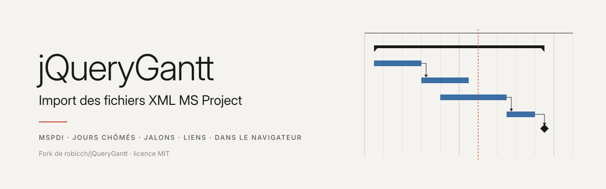

# jQueryGantt · import MS Project

Fork de [robicch/jQueryGantt](https://github.com/robicch/jQueryGantt) qui ouvre les fichiers **XML MS Project** (format MSPDI) directement dans le navigateur.

**Application en ligne :** https://ninjathune-human.github.io/jQueryGantt/

## Ce que l'import reprend

- les tâches, la structure (niveaux de plan), les codes WBS, les notes et le % achevé ;
- les jalons ;
- les liens fin-début et leur décalage en jours ;
- le calendrier du projet : jours de la semaine chômés et jours fériés.

Le fichier est lu sur place : rien n'est envoyé sur un serveur.

## Utilisation

1. Dans MS Project : Fichier > Enregistrer sous, type « Format XML ».
2. Ouvrir l'application, puis le bouton « Ouvrir (JSON ou XML MS Project) », ou glisser le fichier sur le Gantt.

## Limites

- Les liens début-début, fin-fin et début-fin ne sont pas repris (jQueryGantt ne gère que fin-début) ; les avances négatives sont ramenées à 0.
- Les ressources et les affectations ne sont pas importées.
- Les durées sont en jours ouvrés entiers : les heures sont ignorées.
- Pas d'export vers MS Project : l'enregistrement se fait en JSON.

## Modifications par rapport à l'original

- `mspdiImport.js` : conversion MSPDI vers le format de jQueryGantt.
- `index.html` : page d'entrée, tirée de `gantt.html`, avec l'import XML, le glisser-déposer, le calendrier en français et jQuery chargé en https.
- `.github/workflows/pages.yml` : déploiement sur GitHub Pages, puis tag `deploye` placé sur le commit publié.
- `res/banner.svg`, `res/banner.png` : bannière du dépôt.

`gantt.html` reste la page d'origine, inchangée.

---

*README d'origine :*

jQueryGantt
===========
jQuery Gantt editor has been written by Roberto Bicchierai and Silvia Chelazzi

These are some key features:
* jQuery based 3.2
* MIT licensed: you can reuse everywhere https://opensource.org/licenses/MIT
* JSON import-export
* internationalizable
* manage task status –> project workflow
* manage dependencies
* manage assignments (resources, roles efforts)
* server synchronization ready
* full undo-redo support
* cross browser (at least for recent versions)
* keyboard editing support
* SVG visual editor
* print friendly
* collapsible branches
* critical path
* milestones, progress etc.
* zoom

Try the online working demo here: https://gantt.twproject.com

Read here about latest release: https://roberto.twproject.com/2017/04/05/new-gantt-editor-release-the-best-ever/

Read the genesis of this component here: http://roberto.twproject.com/2012/06/14/the-javascript-gantt-odyssey/

Documentation is here: http://roberto.twproject.com/2012/08/24/jquery-gantt-editor/

jQuery Gantt editor is part of <a href="https://twproject.com">Twproject 6</a> project

